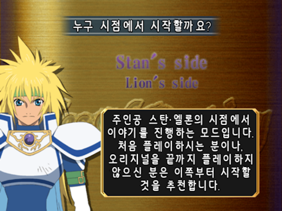
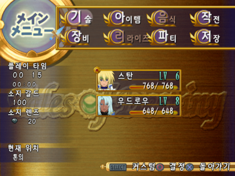
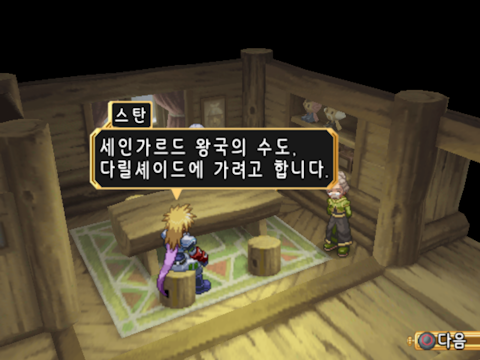
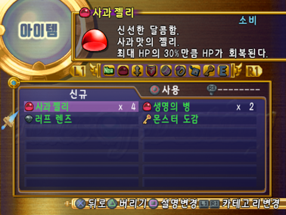
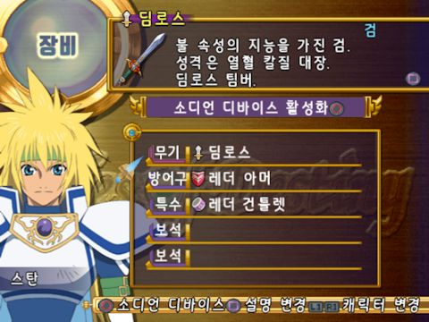
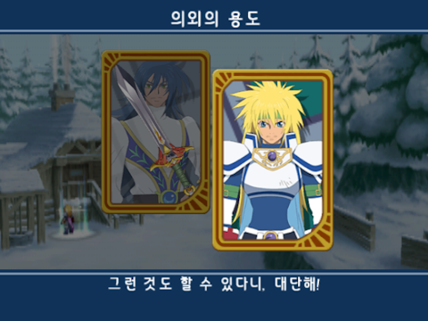

# Tales of Destiny Director's Cut (PS2) 한국어화 패치 (공개 검수 버전)

## 공지

이 프로젝트는 1인 개발 및 소수의 검수 참여자로 진행되고 있습니다. 매 변경점마다 공개 검수 버전을 배포합니다.

매 변경점을 배포하는 이유는 혼자서 검수할 수 있는 양에 한계가 있고, 공개 검수를 통해 더 빠른 완성을 목표로 하기 때문입니다.

게임을 플레이하면서 눈에 보이는 문장의 오류나 버그를 발견하면 [제보](#제보)하거나 [기여](#패치-제작에-참여하기) 해주세요.

- AI 번역은 가끔 실수를 하기도 하고, 미묘한 말투의 뉘앙스나 맥락이 필요한 문장은 사람의 확인 후 교정이 필요합니다.
- 의성어, 존칭 혼동 같은 번역 오류. 줄바꿈, 오타 등의 표기 오류. 사람 이름이나 지명과 같은 고유명사 표기 오류에 대한 많은 제보 바랍니다.
- 교정과 검수 관련되어 도움을 구하는 이슈는 [🐤 help wanted](https://github.com/ToD-DC-Kor/kor-patch/issues?q=sort%3Aupdated-desc+is%3Aissue+is%3Aopen+label%3A%22%F0%9F%90%A4+help+wanted%22) label이 달린 이슈로 관리되고 있습니다. 관심 있으시면 확인 바랍니다.
- 그 외 패치에 도움을 주실 수 있는 분들은 디스코드에서 말씀해주세요.

## 링크

- 디스코드: https://discord.gg/aaZA9avVEz
- 프로젝트 관리: https://github.com/orgs/ToD-DC-Kor/projects/1/views/4

## 진행 상황

### 요약

모든 시나리오, 아이템, 스킬, 스킷 자막 AI를 통한 번역 완료. 실제 플레이하면서 나타나는 문제들은 제보를 통해 수정 중.

### 스크린샷

</img> </img> </img> </img> </img> </img> </img> 

### 상세

번역:

| | 번역 | 검수 |
| - | - | - |
| 시나리오 대사 |  |  |
| 전투 튜토리얼 |  |  |
| 스킷 자막 |  |  |
| 스킷 제목 |  |  |
| 영상 자막 |  |  |
| 지명 |  |  |
| 아이템 설명 |  |  |
| 스킬 설명 |  |  |
| 몬스터 도감 |  |  |
| 몬스터 스킬 |  |  |
| 몬스터 이름 |  |  |
| 줄거리 책 |  |  |
| UI 메뉴 |  |  |

그래픽:

| | 진행도 | 검수 |
| - | - | - |
| 메뉴 UI 글자 |  | ✅ |
| 도감/지도 UI 글자 |  | ✅ |
| 전투 메뉴 UI 글자 |  | ✅ |
| 미니게임 로고/글자 |  | ✅ |
| 아이템 |  | ✅ |
| 엔딩 편지 |  | 🔲 |
| 타이틀 로고 |  | ✅ |

## 배포 주기 & 다운로드

패치는 갱신이 있을 때마다 수시로 배포.

다운로드는 [Releases 페이지](https://github.com/ToD-DC-Kor/kor-patch/releases)에서 확인. XDelta를 이용하여 원본 ISO에 패치.

## 패치 제작에 참여하기

모든 번역 파일을 공개하고 있기 때문에, GitHub Issue나 Pull Request를 통해 기여할 수 있습니다. [GitHub Pull Request 도움말](https://docs.github.com/ko/pull-requests/collaborating-with-pull-requests/proposing-changes-to-your-work-with-pull-requests/creating-a-pull-request), [GitHub Desktop 설치 도움말](https://docs.github.com/ko/desktop/installing-and-authenticating-to-github-desktop/setting-up-github-desktop).

상세한 것은 [CONTRIBUTING.md](./CONTRIBUTING.md)을 참고하세요.

## 제보

제보는 이슈나 디스코드를 이용하세요.

- 버그 제보, 번역 오류 제보: <https://github.com/ToD-DC-Kor/kor-patch/issues/new/choose>
- 디스코드 제보: https://discord.gg/aaZA9avVEz

## Tools

- [Ghidra](https://ghidra-sre.org/)
- [Ghidra Emotion Engine: Reloaded](https://github.com/chaoticgd/ghidra-emotionengine-reloaded)
- [PCSX2](https://pcsx2.net/) Debugger
- [ImHex](https://github.com/WerWolv/ImHex)
- [XDelta](https://www.romhacking.net/utilities/928/)
- [Tales of Destiny Driector's Cut Tools](https://www.romhacking.net/utilities/1419/)
- forked version of [sceWork](https://github.com/lifebottle/sceWork)
- [Pakcomposer Clone](https://github.com/lifebottle/Tales-of-Destiny-DC/tree/master/pakcomposer)
- [Aseprite](https://www.aseprite.org/)
- Hand-maded tools:
  - SLPS string patcher
  - SLPS string find & extractor
  - ISO Patcher
  - LLM Translator
  - Font image creator
  - Memory address converter
  - Hangul(Korean alphabet) font mapper

## Contributors

- [@kexplo](https://github.com/kexplo/), the lead developer and coordinator of this translation project.
  - Responsible for reverse engineering, translation, text proofreading, programming, AI engineering, and overall project management.
- 퍼스트버튼, the graphic asset editor.
  - Editing UI graphic assets.
- SJH, a text proofreader and quality assurance tester.
  - Proofreading translated text, offering suggestions for improvement, functionality testing.
- Grumble, a quality assurance tester.
  - Provided game save data for bug reproduction and functionality testing.
- dlatod84, a text proofreader and quality assurance tester.
  - Proofreading translated text, offering suggestions for improvement, functionality testing.
- Daleth, a copy editor and text proofreader
  - Rewriting entire sentences, proofreading translated text, and offering suggestions for improvement.
- NaKaRy\_Ding, a text proofreader.
  - Proofreading translated text, offering suggestions for improvement.
- Hooha, a text proofreader.
  - Proofreading translated text, offering suggestions for improvement.
- 권형근, a game guide contributor.
  - Provided a translated game guide to assist with text verification.
- 상남자, a text proofreader and playtester.
  - Proofreading translated text, offering suggestions for improvement and playtesting.

## Credits

- RangerRus, [Tales of Destiny Driector's Cut Tools](https://www.romhacking.net/utilities/1419/)
  - Thanks to RangerRus for creating this tool. It has become very easy to extract game data.
- Tales of Destiny DC English Translation Team(Life Bottle), [Repository](https://github.com/lifebottle/Tales-of-Destiny-DC).
  - Thanks to the Tales of Destiny DC English Translation Team(Life Bottle). The information they left in the repository has saved me a lot of time.
